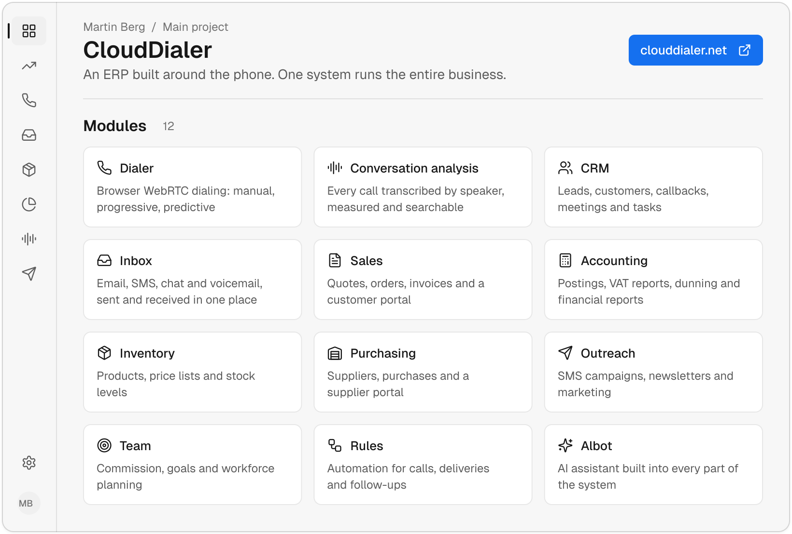

<a href="https://clouddialer.net">
  <picture>
    <source media="(prefers-color-scheme: dark)" srcset="assets/header-dark.svg">
    
  </picture>
</a>

CloudDialer is my main project: an ERP built around the phone, for B2B companies that sell by calling. Dialing, conversation analysis, CRM, email and SMS, quotes, orders, invoicing, accounting, inventory, purchasing and customer and supplier portals are one system. A business needs no other software to run. It runs daily operations for industrial suppliers in Denmark, so the code is private.

## Side projects

- **Glove-liner visualizer and physics simulator.** Reads knitting programs for Shima Seiki glove machines and builds the liner stitch by stitch. It then simulates how the knit stretches, recovers and fits a hand, so changes to gauge, yarn and coating can be judged before a sample is knitted. Developed for the team at href="https://acx.dk"
- **Ravn.** Competitor intelligence for importers. It shows who your competitors buy purchase goods from and what they pay for them. Ravn doesn't rely on bills of lading or customs data. It uses a horrifyingly simple combination of social engineering and maritime law to quite literally break open any container at sea and just hand you the paperwork. Ravn is technically legal and has a 80-90% ish success rate. 

## Stack

Ruby on Rails, Hotwire, Sidekiq, PostgreSQL, WebRTC, Python.
